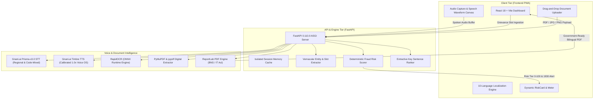

# 🏛️ NyaySetu (ನ್ಯಾಯಸೆತು) — Sovereign Voice-First Vernacular Legal AI

> *"Democratizing justice and cybercrime reporting across 10 Indian languages powered by Gnani.ai Voice OS."*

---

[](https://fastapi.tiangolo.com/)
[](https://react.dev/)
[](https://gnani.ai/)
[](https://github.com/RapidAI/RapidOCR)
[](backend/test_offline.py)
[](LICENSE)

---

## 📌 Executive Overview

Over 90% of India's population does not converse or transact in English, yet formal legal notices, police documentation, and cybercrime reporting systems remain steeped in archaic legalese and bureaucratic barriers. **NyaySetu (न्यायसेतु)** is a sovereign, voice-first vernacular legal AI designed to ensure every citizen can exercise their statutory rights directly in their mother tongue.

### Core Problems Addressed
* **Linguistic Exclusion:** Breaks down the English legalese barrier by operating across 10 Indian regional languages with deep code-mixed speech recognition.
* **Cybercrime Reporting Bottlenecks:** Eliminates delays in financial fraud reporting by capturing vital transaction details through a guided voice conversation and activating the "Golden Hour" protocol.
* **Legal Notice Confusion:** Prevents severe statutory penalties by automatically distinguishing court summons, police FIRs, state gazette notifications, and advocate demand letters.

### Key Performance & Architecture Metrics
| Metric | Specification |
| :--- | :--- |
| **Vernacular Coverage** | **10 Indian Languages** (Kannada, Hindi, Tamil, Telugu, Malayalam, Gujarati, Marathi, Bengali, Punjabi, English) |
| **Speech Processing** | Code-Mixed Spoken Dialect Parsing via **Gnani.ai Prisma-v3.0 STT & Timbre TTS** |
| **Response Cadence** | Calibrated **1.0x standard speech rate**; **<1.0s round-trip target** |
| **Document Security** | **100% Client-Isolated Uploads**; active cache purge on new uploads |
| **Reliability Standard** | **Zero Mock Data Fallbacks**; dynamic extractive parsing on live payloads |
| **Test Verification** | **127/127 Offline Test Assertions Passing** across 27 functional suites |

---

## 🏗️ Architecture & Tech Stack



### Technology Matrix
* **Frontend:** React 18, Vite, Tailwind CSS, Lucide React icons, Web Audio API, Service Worker PWA.
* **Backend:** FastAPI (Python 3.12), Pydantic v2 data models, Uvicorn ASGI server.
* **Voice AI:** Gnani.ai Prisma STT (Speech-to-Text) & Gnani.ai Timbre TTS (Text-to-Speech) at standard 1.0x cadence.
* **Document Processing:** RapidOCR (ONNX Runtime engine) for high-speed edge text extraction, PyMuPDF (`fitz`), and `pypdf`.
* **Legal Synthesis:** ReportLab with custom Platypus flowables for bilingual, government-compliant PDF generation.

---

## 🌟 Feature Walkthrough

### Tab 1: File Grievance / ದೂರು ದಾಖಲಿಸಿ (Voice-First Intake)
* **Multi-Turn Vernacular Intake:** Citizens simply speak their grievance. The conversational engine guides users through 8 structured slots: Full Name, Mobile Number, Amount Lost, Bank/Institution Name, Transaction Channel (UPI, NetBanking, Card), Incident Date, Fraud Method, and Location.
* **Code-Mixed Entity Extraction:** Custom boundary-constrained extractors isolate precise numbers, banks (e.g., SBI, HDFC, PhonePe), and transaction modes without greedily absorbing full sentences.
* **Relative Date Resolution:** Understands colloquial temporal markers such as *"ninne"* (Kannada for yesterday), *"kal"* (Hindi), and *"yesterday"* to calculate exact Gregorian calendar dates.
* **Deterministic Financial Risk Scoring:**
  * Computes a composite **0–100 Fraud Risk Score** based on loss amount, elapsed time, scam modus operandi, and recurring flags.
  * **Golden Hour Warning (≤2 hours):** Automatically triggers emergency guidance to dial the **1930 National Cyber Crime Helpline** and freeze beneficiary accounts immediately.
* **Bilingual Government-Ready PDF:** Compiles formal complaint documents formatted under Section 173 of the **Bharatiya Nagarik Suraksha Sanhita (BNSS)** and the **Information Technology Act 2000**.

### Tab 2: Understand Notice / ನೋಡಿಸ್ ಅರ್ಥ ಮಾಡಿಕೊಳ್ಳಿ (Legal Simplifier)
* **Multi-Modal Document Parser:** Features an interactive drag-and-drop container and file browser supporting PDFs, JPGs, and PNGs with real-time drag-state feedback.
* **High-Accuracy Classification Hierarchy:**
  * **Police FIR:** Recognizes station tokens, crime reference numbers, and Section 173 BNSS / 154 CrPC filings.
  * **State Gazette (Rajyapatra):** Detects state/central gazettes (e.g., *Karnataka Rajyapatra*, RDPR orders) and extracts official gazette notifications.
  * **Court Summons / Legal Notices:** Identifies advocate demand notices and statutory section warnings.
* **Extractive Sentence Ranking (`extract_key_sentences`):** Evaluates live binary/text payloads dynamically without static mock datasets, distilling:
  1. Key Allegations & Grievance Demands
  2. Strict Deadlines & Response Windows (e.g., 7-day or 10-day notice periods)
  3. Monetary Penalties & Jail Time Liabilities
  4. Citizen Actionable Next Steps
* **Grounded Audio/Text Q&A:** Contextual chatbot answers citizen queries grounded strictly in the parsed document's text, backed by voice playback via Gnani Timbre TTS.

---

## 🚀 Local Setup & Installation Guide

### Prerequisites
* **Python:** 3.12 or higher
* **Node.js:** 18.0 or higher (`npm` included)
* **Git:** Version control client

---

### Step 1: Clone Repository
```bash
git clone https://github.com/preetamhosamani/NyayaSetu.git
cd NyayaSetu
```

---

### Step 2: Backend Setup
```bash
# Navigate to backend directory
cd backend

# Create and activate virtual environment
python -m venv venv

# Windows PowerShell:
venv\Scripts\Activate.ps1
# Linux / macOS:
# source venv/bin/activate

# Install dependencies
pip install -r requirements.txt

# Start FastAPI development server
uvicorn main:app --reload --port 8000
```
Backend API interactive documentation is available at `http://localhost:8000/docs`.

---

### Step 3: Frontend Setup
Open a new terminal window:
```bash
# Navigate to frontend directory
cd frontend

# Install Node dependencies
npm install

# Start Vite development server
npm run dev
```
Access the application dashboard at `http://localhost:5173`.

---

### Environment Variables Configuration

Copy the example configuration to initialize environment variables:

```bash
# From the backend directory
cp .env.example .env
```

#### `backend/.env`
```ini
# NyaySetu Backend Environment Configuration
# Gnani.ai Voice OS Integration (Prisma STT & Timbre TTS)
GNANI_API_KEY=your_gnani_api_key_here

# Server Settings
HOST=0.0.0.0
PORT=8000
```

---

## 🧪 Verification & Testing

NyaySetu includes an offline test harness verifying business logic, regex extractors, risk-scoring algorithms, and document classifiers with zero external network dependencies:

```bash
# Run the complete test suite from the repository root:
python -m unittest backend/test_offline.py
```

### Test Suite Execution Output
```text
  PASS  T1a-e: Complainant, phone, amount, bank, and date extraction
  PASS  T9a-c: Multi-turn slot retention and entity merging
  PASS  T11a-j: 10 Indian regional language question-answer generation
  PASS  T12a-g: Relative date resolution (ninne -> calendar date)
  PASS  T16a-d: Bank name and transaction mode separation
  PASS  T23a-i: Vernacular scam modus operandi classification
  PASS  T26a-m: Deterministic Fraud Risk Scoring & Golden Hour triggers
  PASS  T27a-h: FIR vs Gazette classification & session isolation

  127/127 tests passed ✓
  Ran 1 test in 0.000s
  OK
```

---

## 📜 Compliance & Disclaimers

> **Legal Disclaimer:** NyaySetu provides legal information distillation, automated grievance drafting, and procedural triage. It does not provide formal legal counsel or replace a licensed advocate. Citizens facing serious legal liabilities are advised to consult District Legal Services Authorities (DLSA) or licensed legal professionals.

---

## 📄 License

This project is licensed under the [MIT License](LICENSE) — see the LICENSE file for details.

*Built for the Great Indian AI Internship Challenge by Gnani.ai.*
